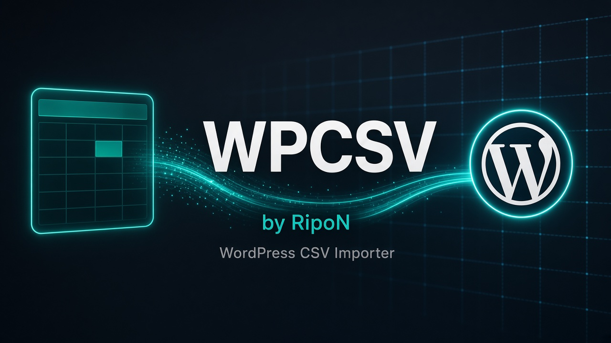

<p align="center">
  
</p>

# WPCSV Express

Fast WP-CLI importer for WordPress. It creates posts from a CSV file, then downloads thumbnail URLs as featured images.

There are only two commands:

1. `wp csv-import posts` — create posts
2. `wp csv-import thumbs` — download featured images

---

## Requirements

- WordPress 5.8 or newer
- PHP 7.4 or newer
- [WP-CLI](https://wp-cli.org/) installed on the server
- `curl` enabled in PHP (used for parallel image downloads)

---

## Install

1. Copy `wpcsv-express.php` into:

   ```
   wp-content/mu-plugins/wpcsv-express.php
   ```

   Must-use plugins load automatically. You do not need to activate anything in wp-admin.

2. Place your CSV in the WordPress root (the same folder as `wp-config.php`). The file **must** be named:

   ```
   posts.csv
   ```

   Typical path:

   ```
   /PathToWPRootFolder/public_html/posts.csv
   ```

---

## CSV structure

Save the file as **UTF-8**. Use a header row. Column names are case-insensitive.

| Column | Required | Description |
|---|---|---|
| `Title` | **Yes** | Post title |
| `video_url` | No | Video URL. Saved as post meta `video_url`. Also used to match existing posts |
| `duration` | No | Duration text. Saved as post meta `duration` |
| `Categories` | No | Comma-separated category names. Created if they do not exist |
| `Model` | No | Comma-separated names. Also accepts `Models`, `Actor`, `Actors`, or `Actress` |
| `Series` | No | Comma-separated series names |
| `Thumbnail` | No | Full image URL. Used by the thumbs command as the featured image |
| `Tags` | No | Comma-separated tags. Created if they do not exist |

### Example `posts.csv`

```csv
Title,duration,video_url,Categories,Model,Series,Thumbnail,Tags
Example One,12:34,https://cdn.example.com/one.mp4,"Drama, New","Jane Doe",Season One,https://cdn.example.com/one.jpg,"tag1, tag2"
Example Two,08:15,https://cdn.example.com/two.mp4,Comedy,John Smith,Season Two,https://cdn.example.com/two.jpg,featured
```

A copy of this layout is in `posts.example.csv`. Rename it to `posts.csv` and replace the sample rows.

### Notes

- Only `Title` is required. Empty title and empty `video_url` rows are skipped.
- Multiple values in `Categories`, `Model`, `Series`, and `Tags` must be separated by commas.
- If your theme registers a `model` (or `actor`) taxonomy, Model / Actor / Actress values are assigned there.
- If your theme registers a `series` taxonomy, Series values are assigned there.
- If those taxonomies are not registered, those columns are ignored. Categories and tags always apply.

---

## Run

SSH into the server, then:

```bash
cd /PathToWPRootFolder/public_html

wp csv-import posts --dry-run
wp csv-import posts

wp csv-import thumbs --dry-run
wp csv-import thumbs
```

Always run `--dry-run` first. It prints counts and does not write to the database or download files.

---

## What each command does

### `wp csv-import posts`

- Reads `posts.csv` from the WordPress root
- Skips a row if the post already exists (matched by `video_url`, then by title)
- Creates missing posts
- Saves `video_url` and `duration` as post meta
- Assigns categories, tags, model, and series
- Spreads publish dates naturally: about 10–25 posts per day, going backward from today
- Posts in the `Uncut` category are created as **pending** instead of published
- Safe to run again. Existing posts are not duplicated

### `wp csv-import thumbs`

- Matches each CSV row to an existing post
- Skips posts that already have a featured image
- Downloads the `Thumbnail` URL into the Media Library
- Sets it as the featured image
- File name and image alt text use the post title
- Safe to run again. Posts that already have an image are skipped

Run **posts first**, then **thumbs**.

---

## Optional flags

| Flag | Commands | Default | Meaning |
|---|---|---|---|
| `--csv=/full/path/file.csv` | both | `posts.csv` in the WordPress root | Use a different CSV path |
| `--batch=500` | posts | `0` (all remaining) | Create at most N new posts this run |
| `--pending-category=Uncut` | posts | `Uncut` | Category that stays pending |
| `--concurrency=8` | thumbs | `8` | Parallel downloads (clamped 4–12) |
| `--dry-run` | both | off | Count only |

Examples:

```bash
wp csv-import posts --csv=/home/user/public_html/posts.csv
wp csv-import posts --batch=500
wp csv-import thumbs --concurrency=8
```

---

## Matching rules

A CSV row matches an existing post when:

1. `video_url` matches post meta `video_url`, or
2. The title matches an existing post title (case-insensitive)

That is how both commands skip work that is already done.

---

## License

GPL-2.0-or-later. See `LICENSE`.
